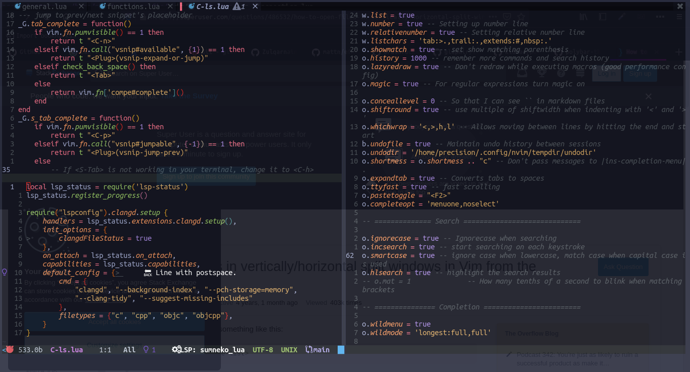
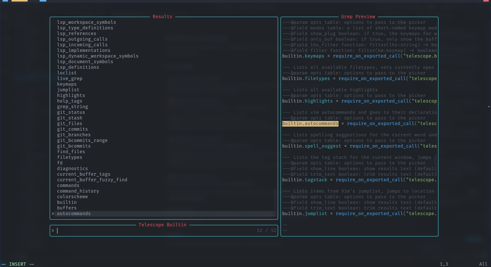
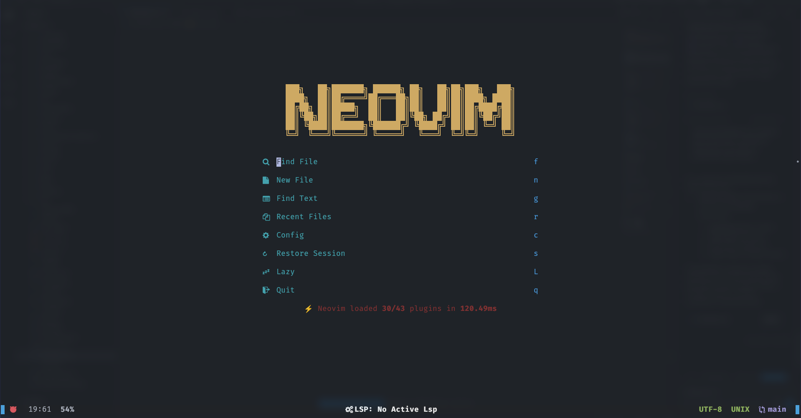
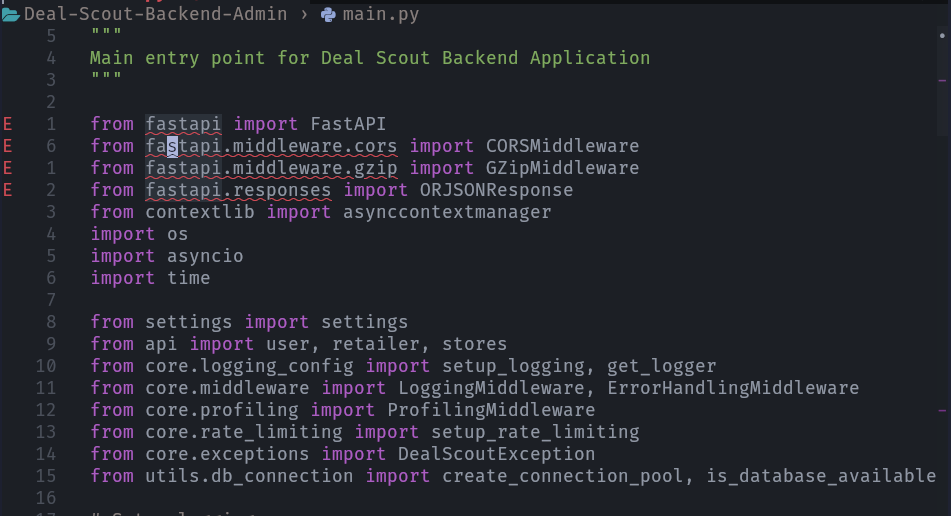

<div align="center">
  

  <h1>Dotfiles</h1>

  <p>
    <b>Aesthetic. Functional. Fast.</b><br>
    <i>A complete, hand-tuned Arch Linux desktop — window manager, editor, shell, and the whole terminal-first workflow around them.</i>
  </p>

  <p>
    <a href="https://github.com/Zulqarnain-cc34/dotfiles/stargazers"></a>
    <a href="https://github.com/Zulqarnain-cc34/dotfiles/network/members"></a>
    <a href="LICENSE"></a>
    
    
  </p>

  
</div>

---

## Contents

- [About](#-about)
- [Gallery](#-gallery)
- [The Stack](#-the-stack)
- [What's Inside](#-whats-inside)
- [Neovim Deep-Dive](#-neovim-deep-dive)
- [Installation](#-installation)
- [Keybindings](#-keybindings)
- [Repository Structure](#-repository-structure)
- [Experimental Wayland Session](#-experimental-wayland-session)
- [Making It Yours](#-making-it-yours)
- [Maintenance](#-maintenance)
- [Credits](#-credits)
- [License](#-license)

---

## 🧭 About

This is my personal Arch Linux configuration — a cohesive, terminal-first desktop built around **BSPWM**, **Neovim**, and **Zsh**, with every piece chosen for speed and kept consistent in look and feel.

The guiding principles:

- **Fast** — measured, not assumed. Neovim boots in ~140 ms; Zsh in ~0.14 s. Plugins lazy-load; expensive work is cached.
- **Keyboard-first** — a tiling WM, fuzzy everything, and TUI apps for mail, music, RSS, files, and browsing.
- **Reproducible** — a single `setup.sh` symlinks everything, package manifests pin the toolset, and a `validate.sh` keeps the repo honest (no leaked paths, no dead tools, no secrets).

> **Primary session is BSPWM (X11).** An experimental niri/Wayland session is also included — see [below](#-experimental-wayland-session).

---

## 📸 Gallery

<div align="center">
<table>
  <tr>
    <td align="center" width="50%"><br><b>Neovim as an IDE</b></td>
    <td align="center" width="50%"><br><b>Fuzzy finding</b></td>
  </tr>
  <tr>
    <td align="center" width="50%"><br><b>Dashboard</b></td>
    <td align="center" width="50%"><br><b>LSP &amp; code actions</b></td>
  </tr>
  <tr>
    <td align="center" colspan="2"><br><b>Polybar</b></td>
  </tr>
</table>
</div>

---

## 🧱 The Stack

<div align="center">

| | Component | Notes |
| :--- | :--- | :--- |
| **OS** |  | Rolling-release base |
| **WM** |  | Binary space partitioning, driven by `sxhkd` |
| **Bar** |  | Custom modules |
| **Shell** |  | `starship` prompt, lazy-loaded, no framework |
| **Terminal** |  | GPU-accelerated (Alacritty as alternate) |
| **Editor** |  | Full IDE, `lazy.nvim` + native LSP (~140 ms) |
| **Launcher** |  | Ribbon theme |
| **Compositor** |  | Blur, shadows, transparency |

</div>

---

## 📦 What's Inside

A complete map of the repo. Deep docs live in each component's own README — linked where available.

### 🪟 Window Manager & Desktop

| Component | Description | Docs |
| :--- | :--- | :--- |
| [`bspwm`](bspwm/) | Tiling window manager (X11) — the primary session | — |
| [`sxhkd`](sxhkd/) | Global hotkey daemon driving BSPWM & app launches | — |
| [`polybar`](polybar/) | Status bar with custom modules | — |
| [`picom`](picom.conf) | Compositor — blur, shadows, transparency | — |
| [`dunst`](dunst/) | Notification daemon | [README](dunst/README.md) |
| [`rofi`](rofi/) | App launcher, window switcher, power menu | [README](rofi/README.md) |
| [`conky`](conky/) | Desktop system widget | — |
| [`redshift`](redshift/) | Night-time colour temperature | — |

### 💻 Terminal & Shell

| Component | Description | Docs |
| :--- | :--- | :--- |
| [`kitty`](kitty/) | Primary GPU-accelerated terminal | — |
| [`alacritty`](alacritty/) | Alternate terminal (TOML config) | [README](alacritty/README.md) |
| [`zsh`](zsh/) | Shell — lazy-loaded plugins, hand-managed | — |
| [`starship.toml`](starship.toml) | Cross-shell prompt | — |
| [`.aliases`](.aliases/) | Shared aliases & helper functions | — |
| [`tmux`](.tmux.conf) | Terminal multiplexer | — |
| [`vivid`](vivid/) | `LS_COLORS` generator (cached) | — |
| [`fastfetch`](fastfetch/) | System info fetch | [README](fastfetch/README.md) |

### ✍️ Editor

| Component | Description | Docs |
| :--- | :--- | :--- |
| [`nvim`](nvim/) | Neovim as a full IDE — see the [deep-dive](#-neovim-deep-dive) | [README](nvim/README.md) |

### 🗄️ File Managers

| Component | Description | Docs |
| :--- | :--- | :--- |
| [`yazi`](yazi/) | **Primary** — fast Rust TUI file manager | [README](yazi/README.md) |
| [`lf`](lf/) | Legacy terminal file manager | [README](lf/README.md) |
| [`ranger`](ranger/) | Legacy terminal file manager | [README](ranger/README.md) |

### 🎵 Media

| Component | Description | Docs |
| :--- | :--- | :--- |
| [`mpv`](mpv/) | Video player (+ scripts) | — |
| [`mpd`](mpd/) + [`ncmpcpp`](ncmpcpp/) | Music daemon + TUI client with cover art | — |
| [`newsboat`](newsboat/) | RSS / Atom reader | — |
| [`zathura`](zathura/) | Keyboard-driven PDF viewer | — |
| [`imv`](imv/) / `nsxiv` | Image viewers | — |
| [`transmission-daemon`](transmission-daemon/) | BitTorrent (RPC bound to localhost) | — |

### 🌐 Web

| Component | Description | Docs |
| :--- | :--- | :--- |
| [`firefox`](firefox/) | Firefox `userChrome` + sweet theme | [docs](docs/firefox.md) |
| [`qutebrowser`](qutebrowser/) | Keyboard-driven browser | — |
| [`.w3m`](.w3m/) | Terminal web browser | — |
| [`surfraw`](surfraw/) | CLI web-search "elvi" | — |
| [`ytfzf`](ytfzf/) | Search & play YouTube from the terminal | — |
| [`mutt`](mutt/) / [`.mutt`](.mutt/) | Neomutt e-mail | — |

### 🛠️ Utilities & Theming

| Component | Description | Docs |
| :--- | :--- | :--- |
| [`bash_scripts`](bash_scripts/) | Host scripts → `~/bin/bash_scripts` | [README](bash_scripts/README.md) |
| [`scripts`](scripts/) | Setup, dependency install & validation | [host index](scripts/host/README.md) |
| [`packages`](packages/) | Pacman / AUR / pip / npm / go manifests | — |
| [`Kvantum`](Kvantum/) | Qt theming engine | — |
| [`urlscan`](urlscan/) / [`urlview`](urlview/) | Extract & open URLs from text | — |

---

## ✨ Neovim Deep-Dive

Not just an editor — a personalised development environment that still boots in ~140 ms.

- **🧩 Plugin manager** — [`lazy.nvim`](https://github.com/folke/lazy.nvim), everything lazy-loaded
- **🎯 Native LSP** — Neovim 0.11+ `vim.lsp.config` / `vim.lsp.enable` for Python, Lua, C/C++, TypeScript/JS, Bash, HTML, JSON, Docker, SQL, GraphQL, Vim
- **⚡ Completion** — [`blink.cmp`](https://github.com/saghen/blink.cmp) with a Rust fuzzy matcher + friendly-snippets
- **🌳 Treesitter** — syntax, indentation, folding, rainbow delimiters, auto-tags
- **🍿 [snacks.nvim](https://github.com/folke/snacks.nvim)** — one coherent UI for the picker, file explorer, notifications, dashboard, indent guides, and more
- **🔭 Fuzzy everything** — files, grep, buffers, help, marks, registers via `snacks.picker`
- **🔀 Git** — Neogit + Diffview
- **🩺 Diagnostics** — Trouble, inline code actions, format-on-demand

See [`nvim/README.md`](nvim/README.md) for the full plugin list and layout.

---

## 🚀 Installation

> ⚠️ These are **personal** dotfiles for Arch Linux. Read what `setup.sh` symlinks before running it, and back up anything you care about.

### Prerequisites

- **Arch Linux** (or an Arch-based distro)
- A **Nerd Font** — the config uses `ttf-jetbrains-mono-nerd` and `ttf-iosevka-nerd`
- `git`, `base-devel`, and an AUR helper (`yay`) for a few packages

### Quick start

```bash
# Clone
git clone https://github.com/Zulqarnain-cc34/dotfiles.git ~/etc/linuxConfig/dotfiles_v2
cd ~/etc/linuxConfig/dotfiles_v2

# Make the helpers executable
chmod +x setup.sh scripts/*.sh

# Install the core package set (or hand-pick from packages/minimal.txt)
./scripts/install-deps.sh

# Symlink configs into ~/.config and $HOME (backs up existing targets first)
./setup.sh --backup

# Enable repo git hooks + run the sanity checks
git config core.hooksPath .githooks
./scripts/validate.sh

# Finally, open Neovim once and let the plugins install
nvim +Lazy sync +qa
```

`setup.sh` flags: `--backup` (copy existing targets to `~/.dotfiles_backup/<timestamp>/` first), `--force` (replace existing targets), `--help`.

Full notes: [`docs/INSTALL.md`](docs/INSTALL.md) · Secrets handling: [`docs/secrets.md`](docs/secrets.md) · Minimal package set: [`packages/minimal.txt`](packages/minimal.txt)

---

## 🎹 Keybindings

Leader key in Neovim is **`m`**. The complete maps live in [`sxhkd/sxhkdrc`](sxhkd/sxhkdrc) and [`nvim/lua/mappings.lua`](nvim/lua/mappings.lua).

<details>
<summary><b>🪟 Window Manager (BSPWM / sxhkd)</b></summary>

| Keys | Action |
| :--- | :--- |
| `Super + T` | Terminal (Kitty) |
| `Super + Space` | App launcher (Rofi ribbon) |
| `Super + Q` / `Super + Shift + Q` | Close / kill window |
| `Super + H/J/K/L` | Focus window (←↓↑→) |
| `Super + D` | Toggle floating |
| `Super + F` | Fullscreen / monocle |
| `Super + Alt + H/J/K/L` | Resize window |
| `Super + {1-9}` | Switch to workspace |
| `Super + Shift + {1-9}` | Send window to workspace |
| `Super + V` | Clipboard menu (clipmenu) |
| `Super + P` | Power menu |
| `Alt + L` | Lock screen (slock) |
| `Print` / `Shift + Print` | Screenshot: full / selection (maim) |

</details>

<details>
<summary><b>🚀 Apps</b></summary>

| Keys | Action |
| :--- | :--- |
| `Super + W` | Firefox |
| `Super + M` | E-mail (Neomutt) |
| `Alt + N` | RSS (Newsboat) |
| `Super + R` | Reddit (tuir) |
| `Super + Y` | YouTube (ytfzf) |
| `Super + O` | Process monitor (htop) |

</details>

<details>
<summary><b>✍️ Neovim (leader = <code>m</code>)</b></summary>

| Keys | Action |
| :--- | :--- |
| `Ctrl + S` | Find files (`snacks.picker`) |
| `<leader>fg` | Live grep |
| `<leader>fb` | Buffers |
| `Ctrl + N` | File explorer (`snacks.explorer`) |
| `K` | Hover docs |
| `<leader>ld` | Go to definition |
| `<leader>lr` | References (Trouble) |
| `<leader>la` | Code action |
| `<leader>le` | Rename symbol |
| `<leader>lf` | Format buffer |
| `<leader>ds` | Buffer diagnostics (Trouble) |
| `<leader>gg` | Git UI (Neogit) |
| `Alt + D` | Toggle terminal |

</details>

---

## 📁 Repository Structure

```text
dotfiles/
├── bspwm/  sxhkd/  polybar/  picom.conf   # Window manager, hotkeys, bar, compositor
├── dunst/  rofi/  conky/  redshift/       # Notifications, launcher, widgets, night colour
├── kitty/  alacritty/                     # Terminals
├── zsh/  .aliases/  starship.toml         # Shell, aliases, prompt
├── nvim/                                  # Neovim (lazy.nvim + native LSP)
├── yazi/  lf/  ranger/                    # File managers (yazi primary)
├── mpv/  mpd/  ncmpcpp/  newsboat/        # Media & feeds
├── qutebrowser/  firefox/  .w3m/  ytfzf/  # Web
├── mutt/  .mutt/  zathura/                # Mail & docs
├── bash_scripts/  scripts/  packages/     # Host scripts, setup helpers, manifests
├── docs/                                  # INSTALL, secrets, firefox
├── setup.sh                               # Symlink deploy
└── CHANGELOG.md                           # Notable repo changes
```

---

## 🌊 Experimental Wayland Session

A work-in-progress **niri** (scrollable-tiling Wayland) session lives alongside the main stack:

- [`niri/`](niri/) — compositor config ([README](niri/README.md)) · [`waybar/`](waybar/) ([README](waybar/README.md)) · [`gammastep/`](gammastep/) (night colour) · [`fish/`](fish/)

It is **not** the primary session — **BSPWM/X11 is the daily driver** — and these pieces are kept for tinkering. Install its extra packages from [`packages/niri-wayland.txt`](packages/niri-wayland.txt) if you want to try it.

---

## 🎨 Making It Yours

1. **Fork**, then clone your fork.
2. Skim [`setup.sh`](setup.sh) — it's a readable list of exactly what gets symlinked where.
3. Set your identity: copy [`.gitconfig.example`](.gitconfig.example) → `.gitconfig` (handled by `scripts/bootstrap-secrets.sh`).
4. Swap colours/fonts in the terminal, `polybar/`, `rofi/themes/`, and your Neovim colourscheme.
5. Run `./scripts/validate.sh` before you commit — it catches dead tools, leaked `$HOME` paths, and secrets.

---

## 🔧 Maintenance

This repo keeps itself honest with [`scripts/validate.sh`](scripts/validate.sh):

- No hardcoded home paths in tracked configs
- No discontinued tools (e.g. guards against `exa` — it's `eza` now)
- No secrets in the index or history ([`gitleaks`](https://github.com/gitleaks/gitleaks) + git hooks)
- Required scripts present and executable; Neovim, Polybar & sxhkd configs load cleanly

```bash
./scripts/validate.sh            # fast checks
./scripts/validate.sh --history  # full gitleaks history scan
```

See [`CHANGELOG.md`](CHANGELOG.md) for notable changes.

---

## 🙏 Credits

- The countless **r/unixporn** and dotfiles authors whose rices sparked ideas
- [`lazy.nvim`](https://github.com/folke/lazy.nvim), [`snacks.nvim`](https://github.com/folke/snacks.nvim), [`blink.cmp`](https://github.com/saghen/blink.cmp) and the wider Neovim plugin community
- [firefox-sweet-theme](https://github.com/EliverLara/firefox-sweet-theme) by EliverLara
- Every tool documented above — maintained by people far more patient than me

---

## 📜 License

Released under the [MIT License](LICENSE) — © 2021 Muhammad Zulqarnain. Use anything you like; attribution appreciated but not required.

---

<div align="center">
  <p>If this was useful or you just like the look, consider leaving a ⭐.</p>
  <p>Made with ❤️ on Arch by <a href="https://github.com/Zulqarnain-cc34">Zulqarnain</a></p>
</div>
