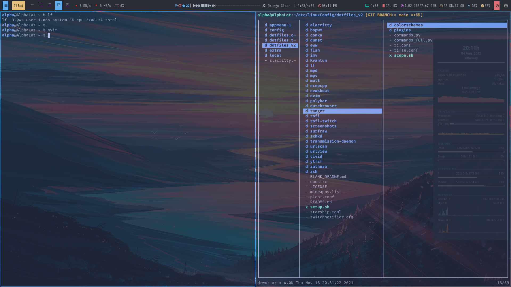
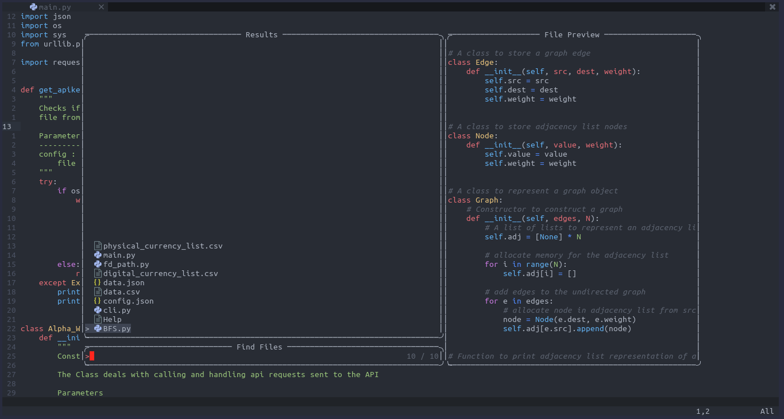
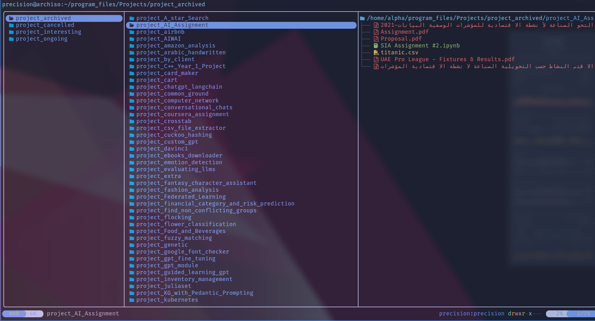
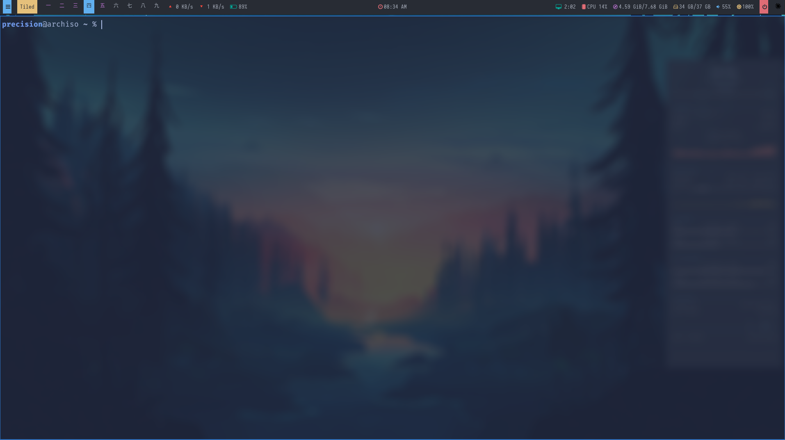
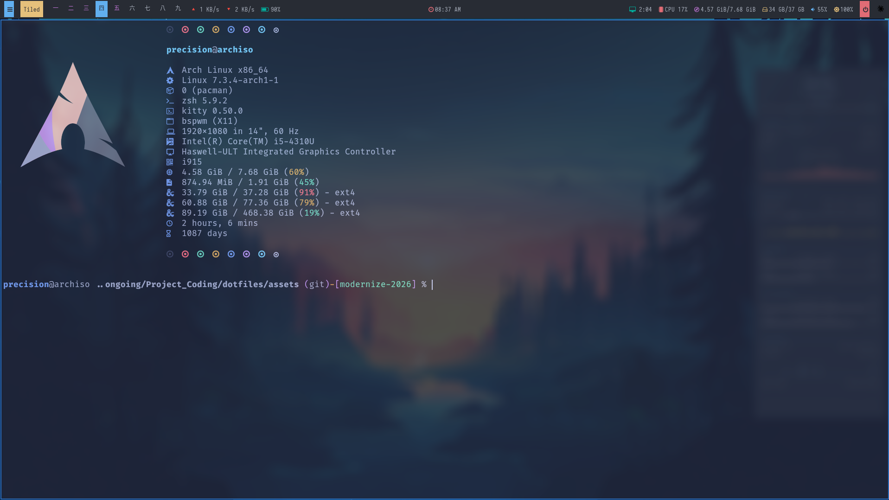
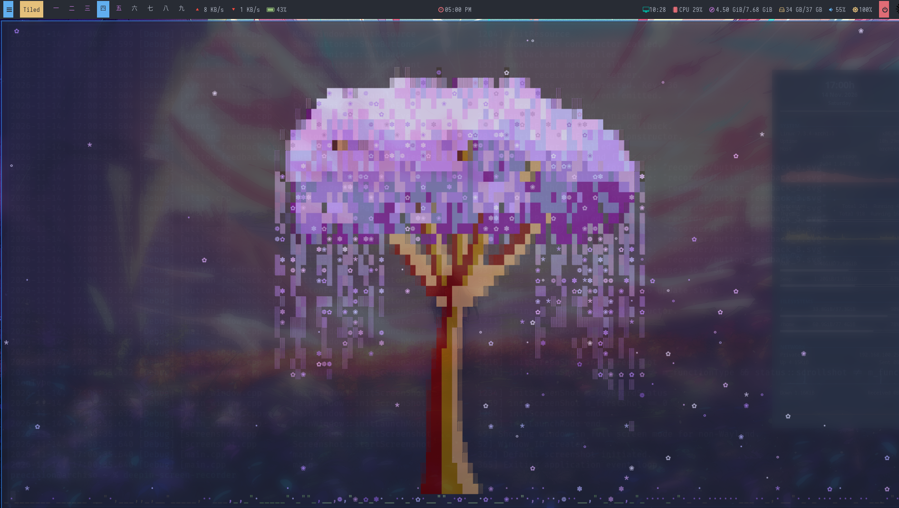
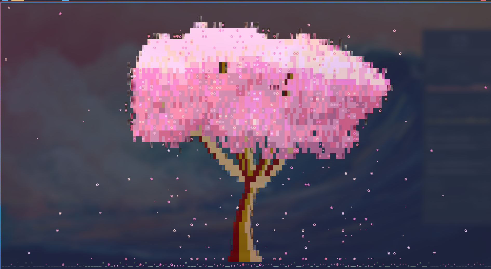
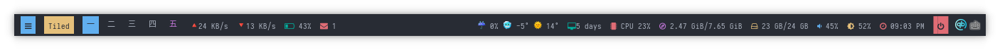

<div align="center">
  

  <h1>Dotfiles</h1>

  <p>
    <b>Aesthetic. Functional. Fast.</b><br>
    <i>A complete, hand-tuned Arch Linux desktop — window manager, editor, shell, and the whole terminal-first workflow around them.</i>
  </p>

  <p>
    <a href="https://github.com/Zulqarnain-cc34/dotfiles/stargazers"></a>
    <a href="https://github.com/Zulqarnain-cc34/dotfiles/network/members"></a>
    <a href="LICENSE"></a>
    
    
    
  </p>

  
</div>

---

## Contents

- [About](#-about)
- [Gallery](#-gallery)
- [The Stack](#-the-stack)
- [What's Inside](#-whats-inside)
- [Installation](#-installation)
- [Keybindings](#-keybindings)
- [Repository Structure](#-repository-structure)
- [Credits](#-credits)

---

## 🧭 About

This is my personal Arch Linux configuration — a cohesive, terminal-first desktop built around **BSPWM**, **Neovim**, and **Zsh**, with every piece chosen for speed and kept consistent in look and feel.

The guiding principles:

- **Fast** — measured, not assumed. Neovim boots in ~140 ms; Zsh in ~0.14 s. Plugins lazy-load; expensive work is cached.
- **Keyboard-first** — a tiling WM, fuzzy everything, and TUI apps for mail, music, RSS, files, and browsing.
- **Reproducible** — a single `setup.sh` symlinks everything, package manifests pin the toolset, and a `validate.sh` keeps the repo honest (no leaked paths, no dead tools, no secrets).

> **Primary session is BSPWM (X11).**

---

## 📸 Gallery

<div align="center">
<table>
  <tr>
    <td align="center" width="50%"><br><b>Neovim as an IDE</b></td>
    <td align="center" width="50%"><br><b>Yazi file manager</b></td>
  </tr>
  <tr>
    <td align="center" width="50%"><br><b>Kitty terminal</b></td>
    <td align="center" width="50%"><br><b>Fastfetch</b></td>
  </tr>
  <tr>
    <td align="center" width="50%"><br><b>Sakura · the four forms</b></td>
    <td align="center" width="50%"><br><b>Sakura · 20s idle, my setup</b></td>
  </tr>
  <tr>
    <td align="center" colspan="2"><br><b>Polybar</b></td>
  </tr>
</table>
</div>

---

## 🧱 The Stack

<div align="center">

| | Component | Notes |
| :--- | :--- | :--- |
| **OS** |  | Rolling-release base |
| **WM** |  | Binary space partitioning, driven by `sxhkd` |
| **Bar** |  | Custom modules |
| **Shell** |  | `starship` prompt, lazy-loaded, no framework |
| **Terminal** |  | GPU-accelerated (Alacritty as alternate) |
| **Editor** |  | Full IDE, `lazy.nvim` + native LSP (~140 ms) |
| **Launcher** |  | Ribbon theme |
| **Compositor** |  | Blur, shadows, transparency |

</div>

---

## 📦 What's Inside

A complete map of the repo. Deep docs live in each component's own README — linked where available.

### 🪟 Window Manager & Desktop

| Component | Description | Docs |
| :--- | :--- | :--- |
| [`bspwm`](bspwm/) | Tiling window manager (X11) — the primary session | [README](bspwm/README.md) |
| [`sxhkd`](sxhkd/) | Global hotkey daemon driving BSPWM & app launches | [README](sxhkd/README.md) |
| [`polybar`](polybar/) | Status bar with custom modules | [README](polybar/README.md) |
| [`picom`](picom.conf) | Compositor — blur, shadows, transparency | — |
| [`dunst`](dunst/) | Notification daemon | [README](dunst/README.md) |
| [`rofi`](rofi/) | App launcher, window switcher, power menu | [README](rofi/README.md) |
| [`conky`](conky/) | Desktop system widget | [README](conky/README.md) |
| [`redshift`](redshift/) | Night-time colour temperature | [README](redshift/README.md) |

### 💻 Terminal & Shell

| Component | Description | Docs |
| :--- | :--- | :--- |
| [`kitty`](kitty/) | Primary GPU-accelerated terminal | [README](kitty/README.md) |
| [`alacritty`](alacritty/) | Alternate terminal (TOML config) | [README](alacritty/README.md) |
| [`zsh`](zsh/) | Shell — lazy-loaded plugins, hand-managed | [README](zsh/README.md) |
| [`starship.toml`](starship.toml) | Cross-shell prompt | — |
| [`.aliases`](.aliases/) | Shared aliases & helper functions | — |
| [`tmux`](.tmux.conf) | Terminal multiplexer | — |
| [`vivid`](vivid/) | `LS_COLORS` generator (cached) | — |
| [`fastfetch`](fastfetch/) | System info fetch | [README](fastfetch/README.md) |
| `csakura` | Cherry-blossom screensaver that blooms when the prompt goes idle | [docs](docs/csakura.md) |

### ✍️ Editor

| Component | Description | Docs |
| :--- | :--- | :--- |
| [`nvim`](nvim/) | Neovim as a full IDE | [README](nvim/README.md) |

### 🗄️ File Managers

| Component | Description | Docs |
| :--- | :--- | :--- |
| [`yazi`](yazi/) | **Primary** — fast Rust TUI file manager | [README](yazi/README.md) |
| [`lf`](lf/) | Legacy terminal file manager | [README](lf/README.md) |
| [`ranger`](ranger/) | Legacy terminal file manager | — |

### 🎵 Media

| Component | Description | Docs |
| :--- | :--- | :--- |
| [`mpv`](mpv/) | Video player (+ scripts) | [README](mpv/README.md) |
| [`mpd`](mpd/) + [`ncmpcpp`](ncmpcpp/) | Music daemon + TUI client with cover art | [mpd](mpd/README.md) · [ncmpcpp](ncmpcpp/README.md) |
| [`newsboat`](newsboat/) | RSS / Atom reader | [README](newsboat/README.md) |
| [`zathura`](zathura/) | Keyboard-driven PDF viewer | [README](zathura/README.md) |
| [`imv`](imv/) / `nsxiv` | Image viewers | [README](imv/README.md) |
| [`transmission-daemon`](transmission-daemon/) | BitTorrent (RPC bound to localhost) | [README](transmission-daemon/README.md) |

### 🌐 Web

| Component | Description | Docs |
| :--- | :--- | :--- |
| [`firefox`](firefox/) | Firefox `userChrome` + sweet theme | [README](firefox/README.md) |
| [`qutebrowser`](qutebrowser/) | Keyboard-driven browser | [README](qutebrowser/README.md) |
| [`.w3m`](.w3m/) | Terminal web browser | — |
| [`surfraw`](surfraw/) | CLI web-search "elvi" | [README](surfraw/README.md) |
| [`ytfzf`](ytfzf/) | Search & play YouTube from the terminal | [README](ytfzf/README.md) |
| [`mutt`](mutt/) / [`.mutt`](.mutt/) | Neomutt e-mail | [README](mutt/README.md) |

### 🛠️ Utilities & Theming

| Component | Description | Docs |
| :--- | :--- | :--- |
| [`bash_scripts`](bash_scripts/) | Host scripts → `~/bin/bash_scripts` | [README](bash_scripts/README.md) |
| [`scripts`](scripts/) | Setup, dependency install & validation | [host index](scripts/host/README.md) |
| [`packages`](packages/) | Pacman / AUR / pip / npm / go manifests | — |
| [`Kvantum`](Kvantum/) | Qt theming engine | — |
| [`urlscan`](urlscan/) / [`urlview`](urlview/) | Extract & open URLs from text | — |

---

## 🚀 Installation

> ⚠️ These are **personal** dotfiles for Arch Linux. Read what `setup.sh` symlinks before running it, and back up anything you care about.

### Prerequisites

- **Arch Linux** (or an Arch-based distro)
- A **Nerd Font** — the config uses `ttf-jetbrains-mono-nerd` and `ttf-iosevka-nerd`
- `git`, `base-devel`, and an AUR helper (`yay`) for a few packages

### Quick start

```bash
# Clone
git clone https://github.com/Zulqarnain-cc34/dotfiles.git ~/etc/linuxConfig/dotfiles_v2
cd ~/etc/linuxConfig/dotfiles_v2

# Make the helpers executable
chmod +x setup.sh scripts/*.sh

# Install the core package set (or hand-pick from packages/minimal.txt)
./scripts/install-deps.sh

# Symlink configs into ~/.config and $HOME (backs up existing targets first)
./setup.sh --backup

# Enable repo git hooks + run the sanity checks
git config core.hooksPath .githooks
./scripts/validate.sh

# Finally, open Neovim once and let the plugins install
nvim +Lazy sync +qa
```

`setup.sh` flags: `--backup` (copy existing targets to `~/.dotfiles_backup/<timestamp>/` first), `--force` (replace existing targets), `--dry-run` (print what would happen, touch nothing), `--check` (report per-target drift, touch nothing), `--help`.

Full notes: [`docs/INSTALL.md`](docs/INSTALL.md) · Secrets handling: [`docs/secrets.md`](docs/secrets.md) · Minimal package set: [`packages/minimal.txt`](packages/minimal.txt)

---

## 🎹 Keybindings

Leader key in Neovim is **`m`**. The complete maps live in [`sxhkd/sxhkdrc`](sxhkd/sxhkdrc) and [`nvim/lua/mappings.lua`](nvim/lua/mappings.lua).

<details>
<summary><b>🪟 Window Manager (BSPWM / sxhkd)</b></summary>

| Keys | Action |
| :--- | :--- |
| `Super + T` | Terminal (Kitty) |
| `Super + Space` | App launcher (Rofi ribbon) |
| `Super + Q` / `Super + Shift + Q` | Close / kill window |
| `Super + H/J/K/L` | Focus window (←↓↑→) |
| `Super + D` | Toggle floating |
| `Super + F` | Fullscreen / monocle |
| `Super + Alt + H/J/K/L` | Resize window |
| `Super + {1-9}` | Switch to workspace |
| `Super + Shift + {1-9}` | Send window to workspace |
| `Super + V` | Clipboard menu (clipmenu) |
| `Super + P` | Power menu |
| `Alt + L` | Lock screen (slock) |
| `Print` / `Shift + Print` | Screenshot: full / selection (maim) |

</details>

<details>
<summary><b>🚀 Apps</b></summary>

| Keys | Action |
| :--- | :--- |
| `Super + W` | Firefox |
| `Super + M` | E-mail (Neomutt) |
| `Alt + N` | RSS (Newsboat) |
| `Super + R` | Reddit (tuir) |
| `Super + Y` | YouTube (ytfzf) |
| `Super + O` | Process monitor (htop) |

</details>

<details>
<summary><b>✍️ Neovim (leader = <code>m</code>)</b></summary>

| Keys | Action |
| :--- | :--- |
| `Ctrl + S` | Find files (`snacks.picker`) |
| `<leader>fg` | Live grep |
| `<leader>fb` | Buffers |
| `Ctrl + N` | File explorer (`snacks.explorer`) |
| `K` | Hover docs |
| `<leader>ld` | Go to definition |
| `<leader>lr` | References (Trouble) |
| `<leader>la` | Code action |
| `<leader>le` | Rename symbol |
| `<leader>lf` | Format buffer |
| `<leader>ds` | Buffer diagnostics (Trouble) |
| `<leader>gg` | Git UI (Neogit) |
| `Alt + D` | Toggle terminal |

</details>

---

## 📁 Repository Structure

```text
dotfiles/
├── bspwm/  sxhkd/  polybar/  picom.conf   # Window manager, hotkeys, bar, compositor
├── dunst/  rofi/  conky/  redshift/       # Notifications, launcher, widgets, night colour
├── kitty/  alacritty/                     # Terminals
├── zsh/  .aliases/  starship.toml         # Shell, aliases, prompt
├── nvim/                                  # Neovim (lazy.nvim + native LSP)
├── yazi/  lf/                             # File managers (yazi primary)
├── mpv/  mpd/  ncmpcpp/  newsboat/        # Media & feeds
├── qutebrowser/  firefox/  .w3m/  ytfzf/  # Web
├── mutt/  .mutt/  zathura/                # Mail & docs
├── bash_scripts/  scripts/  packages/     # Host scripts, setup helpers, manifests
├── docs/                                  # INSTALL, secrets, firefox
├── setup.sh                               # Symlink deploy
└── CHANGELOG.md                           # Notable repo changes
```

---

<div align="center">

## ❤️ Credits

None of this is mine to take credit for. It's the work of the people who build and
maintain the tools these configs sit on top of, plus the **r/unixporn** and dotfiles
community whose rices sparked half the ideas here. Huge thanks to all of them.

<a href="https://github.com/neovim" title="Neovim"></a> <!-- group: Tools & projects -->
<a href="https://github.com/kovidgoyal" title="kitty"></a>
<a href="https://github.com/sxyazi" title="yazi"></a>
<a href="https://github.com/gokcehan" title="lf"></a>
<a href="https://github.com/baskerville" title="bspwm / sxhkd"></a>
<a href="https://github.com/polybar" title="Polybar"></a>
<a href="https://github.com/yshui" title="picom"></a>
<a href="https://github.com/dunst-project" title="dunst"></a>
<a href="https://github.com/davatorium" title="rofi"></a>
<a href="https://github.com/alacritty" title="Alacritty"></a>
<a href="https://github.com/mpv-player" title="mpv"></a>
<a href="https://github.com/MusicPlayerDaemon" title="MPD"></a>
<a href="https://github.com/newsboat" title="Newsboat"></a>
<a href="https://github.com/neomutt" title="NeoMutt"></a>
<a href="https://github.com/pwmt" title="zathura"></a>
<a href="https://github.com/qutebrowser" title="qutebrowser"></a>
<a href="https://github.com/jonls" title="redshift"></a>
<a href="https://github.com/YaLTeR" title="niri"></a>
<a href="https://github.com/Alexays" title="Waybar"></a>
<a href="https://github.com/fish-shell" title="fish"></a>
<a href="https://github.com/sharkdp" title="vivid / fd / bat"></a>
<a href="https://github.com/pystardust" title="ytfzf"></a>
<a href="https://github.com/transmission" title="Transmission"></a>
<a href="https://github.com/EliverLara" title="firefox-sweet-theme"></a>
<a href="https://github.com/starship" title="Starship prompt"></a>
<a href="https://github.com/junegunn" title="fzf"></a>
<a href="https://github.com/eza-community" title="eza"></a>
<a href="https://github.com/tmux" title="tmux"></a>
<a href="https://github.com/fastfetch-cli" title="Fastfetch"></a>
<a href="https://github.com/brndnmtthws" title="Conky"></a>
<a href="https://github.com/arybczak" title="ncmpcpp"></a>
<a href="https://github.com/ranger" title="ranger"></a>
<a href="https://github.com/tsujan" title="Kvantum"></a>
<a href="https://github.com/tats" title="w3m"></a>
<a href="https://github.com/firecat53" title="urlscan"></a>
<a href="https://github.com/sigpipe" title="urlview"></a>
<a href="https://github.com/hpjansson" title="chafa (image preview)"></a>
<a href="https://github.com/charmbracelet" title="glow (markdown preview)"></a>
<a href="https://github.com/andreafrancia" title="trash-cli"></a>
<a href="https://github.com/wting" title="autojump"></a>
<a href="https://github.com/realstrawhat" title="csakura (sakura terminal screensaver)"></a>
<a href="https://github.com/zsh-users" title="zsh-autosuggestions · zsh-syntax-highlighting"></a> <!-- group: Shell, prompt & tmux plugins -->
<a href="https://github.com/jorgebucaran" title="fisher (fish plugin manager)"></a>
<a href="https://github.com/rafaelrinaldi" title="pure (fish prompt)"></a>
<a href="https://github.com/jethrokuan" title="fzf.fish"></a>
<a href="https://github.com/oh-my-fish" title="plugin-foreign-env"></a>
<a href="https://github.com/tmux-plugins" title="tpm · sensible · battery · cpu · urlview · yank · copycat"></a>
<a href="https://github.com/yazi-rs" title="full-border · git · chmod · jump-to-char · toggle-pane · smart-enter · piper · vcs-files · catppuccin flavor"></a> <!-- group: Yazi plugins & flavors -->
<a href="https://github.com/Rolv-Apneseth" title="starship (yazi plugin)"></a>
<a href="https://github.com/DreamMaoMao" title="mime-preview (yazi plugin)"></a>
<a href="https://github.com/kalidyasin" title="tokyonight-storm (yazi flavor)"></a>
<a href="https://github.com/folke" title="snacks · lazy · which-key · trouble · todo-comments · persistence · styler · lazydev · tokyonight"></a> <!-- group: Neovim plugin authors -->
<a href="https://github.com/saghen" title="blink.cmp"></a>
<a href="https://github.com/stevearc" title="conform.nvim"></a>
<a href="https://github.com/mfussenegger" title="nvim-lint"></a>
<a href="https://github.com/nvim-treesitter" title="nvim-treesitter"></a>
<a href="https://github.com/nvim-lua" title="plenary.nvim"></a>
<a href="https://github.com/nvim-telescope" title="telescope.nvim"></a>
<a href="https://github.com/nvim-tree" title="nvim-web-devicons"></a>
<a href="https://github.com/nvim-lualine" title="lualine.nvim"></a>
<a href="https://github.com/NeogitOrg" title="neogit"></a>
<a href="https://github.com/sindrets" title="diffview.nvim"></a>
<a href="https://github.com/akinsho" title="bufferline.nvim"></a>
<a href="https://github.com/catgoose" title="nvim-colorizer.lua"></a>
<a href="https://github.com/petertriho" title="nvim-scrollbar"></a>
<a href="https://github.com/ellisonleao" title="gruvbox.nvim"></a>
<a href="https://github.com/navarasu" title="onedark.nvim"></a>
<a href="https://github.com/sphamba" title="smear-cursor.nvim"></a>
<a href="https://github.com/HiPhish" title="rainbow-delimiters.nvim"></a>
<a href="https://github.com/windwp" title="nvim-ts-autotag"></a>
<a href="https://github.com/OXY2DEV" title="markview.nvim"></a>
<a href="https://github.com/iamcco" title="markdown-preview.nvim"></a>
<a href="https://github.com/dstein64" title="vim-startuptime"></a>
<a href="https://github.com/rafamadriz" title="friendly-snippets"></a>
<a href="https://github.com/MunifTanjim" title="nui.nvim"></a>
<a href="https://github.com/amitds1997" title="remote-nvim.nvim"></a>
<a href="https://github.com/nemanjamalesija" title="smart-paste.nvim"></a>
<a href="https://github.com/b0o" title="schemastore.nvim"></a>
<a href="https://github.com/alphapapa" title="qutebrowser site themes (solarized-everything-css)"></a> <!-- group: Borrowed scripts & themes -->
<a href="https://github.com/seebye" title="ueberzug (image preview backend)"></a>
<a href="https://github.com/gotbletu" title="shell scripts (urlportal, redshift-toggle)"></a>
<a href="https://github.com/chubin" title="cheat.sh (cht.sh)"></a>
<a href="https://github.com/livibetter" title="pipesX.sh colorscript"></a>
<a href="https://github.com/rossy" title="mpv repl.lua (powers sub-search)"></a>
<a href="https://github.com/adi1090x" title="Aditya Shakya — rofi applets/launchers/powermenu + polybar config"></a>
<a href="https://github.com/arcticicestudio" title=".dir_colors (Nord dircolors)"></a>
<a href="https://github.com/Andr3as07" title="polybar sb-tasks script"></a>

</div>

<div align="center">
<sub>© 2021 Muhammad Zulqarnain. <a href="LICENSE">MIT License</a>.</sub>
</div>
