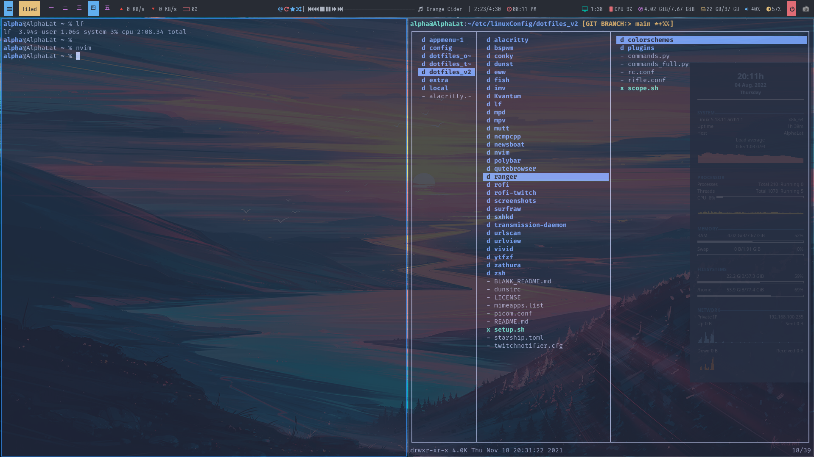

  <h1>BSPWM</h1>
  
<em>The tiling window manager — binary space partitioning, scripted via <code>bspc</code>.</em>

  
  
  
    
  

> Powered by **[bspwm](https://github.com/baskerville/bspwm)** by Bastien Dejean (baskerville). ❤️

A tiling window manager that arranges windows by splitting space in two, over and over — it's the primary X11 session for these dotfiles, kept deliberately tight with thin borders and barely-there gaps.

The single monitor runs nine desktops labelled with CJK numerals (`一 二 三 四 五 六 七 八 九`). Windows get a `border_width` of 2, a `window_gap` of 2, and split evenly down the middle (`split_ratio 0.50`); monocle mode drops both the borders and gaps so a single window fills the screen cleanly. The pointer leads focus, new splits favour the second child, and the automatic layout alternates as you go. A handful of apps get their own rules: `mpv` opens fullscreen, `Zathura` tiled, `Gimp` floats onto desktop 8 and follows, `Chromium` lands on desktop 2, `mplayer2` floats, `Screenkey` stays unmanaged, and `Kupfer.py` grabs focus.

The tail of `bspwmrc` is the autostart list — conky1, picom, sxhkd, dunst, redshift, a random wallpaper, clipmenud, xmodmap, and polybar (via `launch.sh`) all come up with the session.

### Keybindings

None of them live here — hotkeys are owned by sxhkd, launched as `sxhkd &` from `bspwmrc`. See [`sxhkd/`](../sxhkd) for the full table.

### Setup

You'll need `bspwm` and `sxhkd` at minimum; the autostart also pulls in `picom`, `dunst`, `redshift`, `xorg-xset`, `xorg-xmodmap`, `clipmenu`, `polybar`, and `conky`. The default terminal is `kitty` (via `$TERMINAL`).

Everything runs out of one executable script, [`bspwmrc`](bspwmrc): monitor and desktop setup, global config, window rules, border colours, and that autostart block. To re-theme, edit the `*_border_color` lines (focused `#327bd1`, normal `#4c566a`, urgent `#dd2727`); gaps and borders are the `window_gap` / `border_width` / `split_ratio` lines near the top, and there are commented-out padding presets under "Monitor And Desktop Settings" if you want them.
