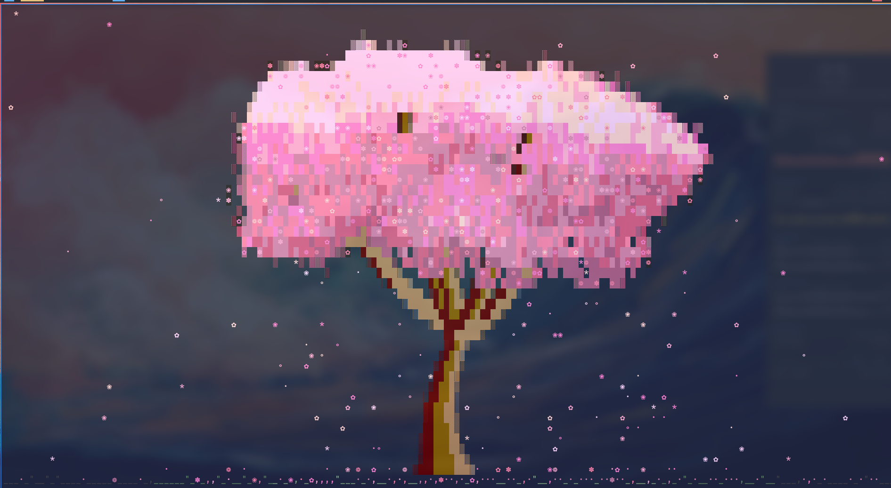

  <h1>🌸 Sakura</h1>
  
<em>A cherry-blossom tree that quietly blooms in your terminal when you step away.</em>

  
  
  
  
    

  

> Built on **[csakura](https://github.com/realstrawhat/csakura)** by realstrawhat — a lovely little tree for the terminal. ❤️

This is a screensaver for your terminal. Leave the prompt sitting there for a few
seconds and a cherry-blossom tree grows in, petals drifting down on a little
breeze. Touch any key, or just move the mouse over the terminal, and it's gone,
right back to where you were — the same idle-dismiss behaviour a desktop
screensaver uses. That's the whole idea — something pretty to come back to,
that never gets in your way.

## What happens, step by step

- **You stop typing.** After **60 seconds** of an empty, idle prompt, the tree
  blooms on its own.
- **It keeps you company.** While it's up, every **45 seconds** it grows a fresh
  tree in a new shape (upright, bushy, or weeping) and a new colour — so it slowly
  drifts through all of them instead of sitting still.
- **Each time starts on a new colour.** First bloom is pink (sakura), the next is
  rose, then blush… marching through all 15 colours and looping back around.
- **Any key, or just the mouse, brings you back.** Press anything — a letter,
  space, an arrow — or move the mouse over the terminal window, and it vanishes
  instantly. That input just closes it; a key isn't typed into your prompt and
  a mouse move isn't clicked anywhere.

It only ever shows up at an **empty prompt**. If you're halfway through typing a
command, or something's actually running, it leaves you alone.

## Make it yours

Everything lives at the bottom of [`zsh/.zshrc`](../zsh/.zshrc), and there are
really only two dials:

| You want to… | Change this |
|---|---|
| Bloom sooner / later | `TMOUT=60` — seconds of idle before it appears |
| Drift faster / slower | `-C 45` — seconds between each new tree while it's up |
| Freeze on one tree | `-C 0` (or remove it) |
| Turn it off for now | `TMOUT=0` in the current shell |
| Turn it off for good | comment out the block |
| Always start weeping, windier, etc. | add flags, e.g. `_csakura_base=(csakura -k -C 45 -w 3)` |

Want to just watch it yourself any time? Run `csakura` in a terminal (press `q` to
quit), and `csakura -h` lists every option. The colours are: sakura, rose, blush,
magenta, peach, coral, sunset, gold, lavender, violet, sky, mint, matcha, white,
ink — and the tree shapes are `yoshino` (upright), `bush` (full), and `shidare`
(weeping).

## Where things live

| Thing | Path |
|------|------|
| The program | `csakura/csakura` — built from source on setup (not committed), symlinked onto `PATH` via `bash_scripts/` |
| Its source + build | [`csakura/csakura.src/`](csakura.src/) (patched source + Makefile); [`build.sh`](build.sh) compiles it |
| The bit that makes it auto-start when idle | bottom of [`zsh/.zshrc`](../zsh/.zshrc) |

## Good to know

- **Each window does its own thing.** The tree only appears in the window you left
  idle; others are untouched.
- **It's gentle on the machine.** It only draws while it's on screen (and nothing
  at all while you're working), so it won't spin up the fan.
- **If it ever looks broken** (e.g. a bare error instead of a tree), it's almost
  always a terminal with no proper `TERM` set — real kitty/alacritty are fine.
- **It's built from source on setup.** The binary isn't committed (the repo stays
  binary-free); `setup.sh` runs `csakura/build.sh` to compile the vendored source into
  `csakura/csakura`, which a `bash_scripts/` symlink puts first on your `PATH`. The
  `-k`/`-C` behaviour only exists in this build, so if a plain `csakura` from the AUR
  ever shadowed it, the any-key/mouse-close and drift would stop — keep this one ahead on `PATH`.
