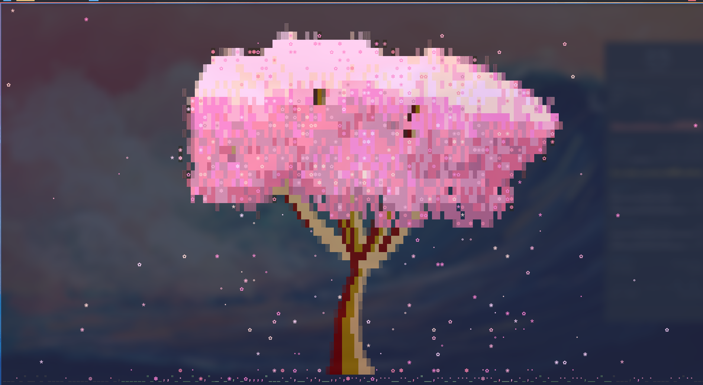

<div align="center">
  <h1>🌸 Sakura</h1>
  <p><em>A cherry-blossom tree that quietly blooms in your terminal when you step away.</em></p>

  <a href="https://github.com/realstrawhat/csakura"></a>
  <a href="https://github.com/realstrawhat/csakura/stargazers"></a>
  
  
  <br><br>

  
</div>

> Built on **[csakura](https://github.com/realstrawhat/csakura)** by realstrawhat — a lovely little tree for the terminal. ❤️

This is a screensaver for your terminal. Leave the prompt sitting there for a few
seconds and a cherry-blossom tree grows in, petals drifting down on a little
breeze. Touch any key and it's gone, right back to where you were. That's the
whole idea — something pretty to come back to, that never gets in your way.

## What happens, step by step

- **You stop typing.** After **20 seconds** of an empty, idle prompt, the tree
  blooms on its own.
- **It keeps you company.** While it's up, every **45 seconds** it grows a fresh
  tree in a new shape (upright, bushy, or weeping) and a new colour — so it slowly
  drifts through all of them instead of sitting still.
- **Each time starts on a new colour.** First bloom is pink (sakura), the next is
  rose, then blush… marching through all 15 colours and looping back around.
- **Any key brings you back.** Press anything — a letter, space, an arrow — and it
  vanishes instantly. That key just closes it; it isn't typed into your prompt.

It only ever shows up at an **empty prompt**. If you're halfway through typing a
command, or something's actually running, it leaves you alone.

## Make it yours

Everything lives at the bottom of [`zsh/.zshrc`](../zsh/.zshrc), and there are
really only two dials:

| You want to… | Change this |
|---|---|
| Bloom sooner / later | `TMOUT=20` — seconds of idle before it appears |
| Drift faster / slower | `-C 45` — seconds between each new tree while it's up |
| Freeze on one tree | `-C 0` (or remove it) |
| Turn it off for now | `TMOUT=0` in the current shell |
| Turn it off for good | comment out the block |
| Always start weeping, windier, etc. | add flags, e.g. `_csakura_base=(csakura -k -C 45 -w 3)` |

Want to just watch it yourself any time? Run `csakura` in a terminal (press `q` to
quit), and `csakura -h` lists every option. The colours are: sakura, rose, blush,
magenta, peach, coral, sunset, gold, lavender, violet, sky, mint, matcha, white,
ink — and the tree shapes are `yoshino` (upright), `bush` (full), and `shidare`
(weeping).

## Where things live

| Thing | Path |
|------|------|
| The program itself | [`bash_scripts/csakura`](../bash_scripts/csakura) |
| Its source code, if you ever want to rebuild it | [`bash_scripts/csakura.src/`](../bash_scripts/csakura.src/) |
| The bit that makes it auto-start when idle | bottom of [`zsh/.zshrc`](../zsh/.zshrc) |

---

## Under the hood

*You don't need any of this to use it — it's here for the curious, or for future-me.*

**How it auto-starts.** There's no background program watching you. It's a built-in
zsh feature: `TMOUT` tells zsh "nudge me after N idle seconds," and a `TRAPALRM`
function says what to do with that nudge — here, run the tree. Because zsh only
counts idle time at the prompt, it never interrupts a running command, and a quick
`[[ -z "$BUFFER" ]]` check means it won't pop up while you're mid-way through
typing something.

**Two small changes to the program.** Stock csakura only quits on `q`/`Esc` and
never changes on its own, so this repo ships a tiny patch
([`csakura.src/anykey.patch`](../bash_scripts/csakura.src/anykey.patch)) adding two
switches:

- `-k` — **any key quits.** What makes it behave like a real screensaver. (With
  this on, even the normal shortcut keys just close it, so there's nothing to get
  in the way.)
- `-C 45` — **drift every 45 seconds.** The reason the tree and colours keep
  changing while it's open. This has to live inside the program, because while the
  tree is on screen it owns the terminal and the shell can't reach in to change it.

**Remembering the colour.** The "next colour each time" is kept in a little file at
`~/.cache/csakura-palette` (just a number), so the cycle keeps moving forward even
across different windows and reboots. Delete that file and it starts from pink
again.

## Rebuilding it

The ready-to-run program is a Linux x86-64 build. On your own machines it just
works. If you ever need it on different hardware (an ARM board, say) or you tweak
the source, rebuild it — you'll need a C compiler and the `ncurses` package:

```bash
cd ~/etc/linuxConfig/dotfiles_v2/bash_scripts/csakura.src
make
cp csakura ../csakura
```

`anykey.patch` is the exact set of local changes, and applies cleanly to a fresh
copy of upstream csakura v3.0.0 (`patch -p1 < anykey.patch`).

## Good to know

- **Each window does its own thing.** The tree only appears in the window you left
  idle; others are untouched.
- **It's gentle on the machine.** It only draws while it's on screen (and nothing
  at all while you're working), so it won't spin up the fan.
- **If it ever looks broken** (e.g. a bare error instead of a tree), it's almost
  always a terminal with no proper `TERM` set — real kitty/alacritty are fine.
- **It needs its own build.** The `-k`/`-C` behaviour only exists in the version
  shipped here; a plain `csakura` from the AUR won't drift or close on any key.
  (The config notices this and quietly falls back to the basic behaviour.)
