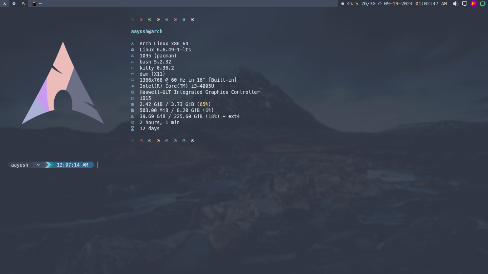

# Fastfetch

A fast system-info fetch for the terminal — the little logo-and-specs banner that greets you on shell start. This config is tuned for Arch with a custom module layout and a choice of ASCII or image logos.

### What's here

The layout lives in [`config.jsonc`](config.jsonc) — which modules appear (OS, kernel, uptime, packages, WM, terminal, and so on), their order, and the colours. Logos come in two flavours: text art under [`ascii/`](ascii/) (`arch`, `cat`, `rose`, `triangle`) and raster images under [`images/`](images/) and [`pngs/`](pngs/). Point the `logo` block in `config.jsonc` at whichever one you're in the mood for.
