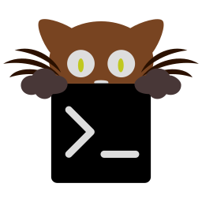

    
  <h1>kitty</h1>
  
<em>The primary terminal — GPU-accelerated, fast, endlessly scriptable.</em>

  
  
  

<!-- Screenshot slot: add assets/kitty-shot.png, then uncomment → 

 -->

> Built on **[kitty](https://sw.kovidgoyal.net/kitty/)** by Kovid Goyal. ❤️

A GPU-accelerated terminal emulator, and the primary terminal in this setup — Tokyo Night (storm) palette, `FiraCode Nerd Font`, launching straight into Zsh. The config ([`kitty.conf`](kitty.conf)) stays deliberately close to kitty's defaults; the notable customizations are below.

### Appearance

- Tokyo Night **storm** palette — the full 16-color set plus cursor, selection, window borders and tab bar.
- `FiraCode Nerd Font`, with the bold and italic faces derived automatically (`bold_font auto`, `italic_font auto`, `bold_italic_font auto`).
- `background_opacity 0.90`, so a little of the desktop shows through.
- Tab bar uses the `fade` style.

### Font size per session

`font_size.conf` is a symlink that [`scripts/link-font-size.sh`](scripts/link-font-size.sh) repoints at login, so each session gets a fitting size automatically:

| Session | `font_size` | Snippet |
|---------|-------------|---------|
| bspwm | 13 | [`font_size-bspwm.conf`](font_size-bspwm.conf) |
| anything else (niri, …) | 11 | [`font_size-default.conf`](font_size-default.conf) |

The script detects bspwm (via `pgrep` and the session environment) and is invoked from [`bspwm/bspwmrc`](../bspwm/bspwmrc) and [`niri/autostart.sh`](../niri/autostart.sh).

### Behavior

- `shell /usr/bin/zsh` — opens straight into Zsh.
- `shell_integration disabled`.
- `confirm_os_window_close 0` — closing a window never prompts.

### Keybindings

Rides kitty's built-in defaults; the only custom map:

| Key | Action |
|-----|--------|
| `ctrl+shift+t` | open a new tab in the current directory (`new_tab_with_cwd`) |

> kitty's graphics protocol is also what powers the inline image previews in [yazi](../yazi/README.md) and [lf](../lf/README.md).
