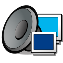

    
  <h1>mpd</h1>
  
<em>Music Player Daemon — the backend that holds the library.</em>

  
  
  

> Built on **[MPD](https://www.musicpd.org)** by Max Kellermann & the MPD project. ❤️

Music Player Daemon — the quiet backend that holds the music library and feeds the clients. Nothing here is user-facing; ncmpcpp (or `mpc`) does the talking, mpd just plays.

The library lives at `~/Music/` and re-scans itself whenever files change. State, database, and playlists all sit under `~/.config/mpd/`. The daemon binds to `127.0.0.1` only, so it's reachable at `localhost:6600` and nowhere else.
