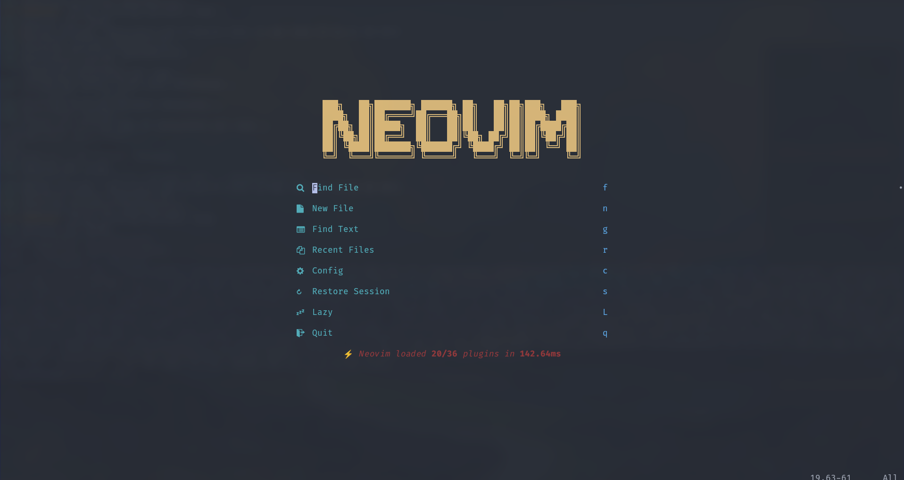
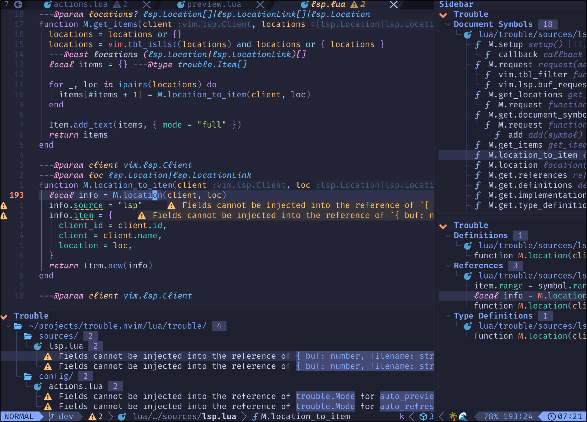
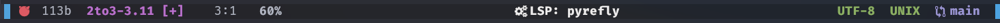
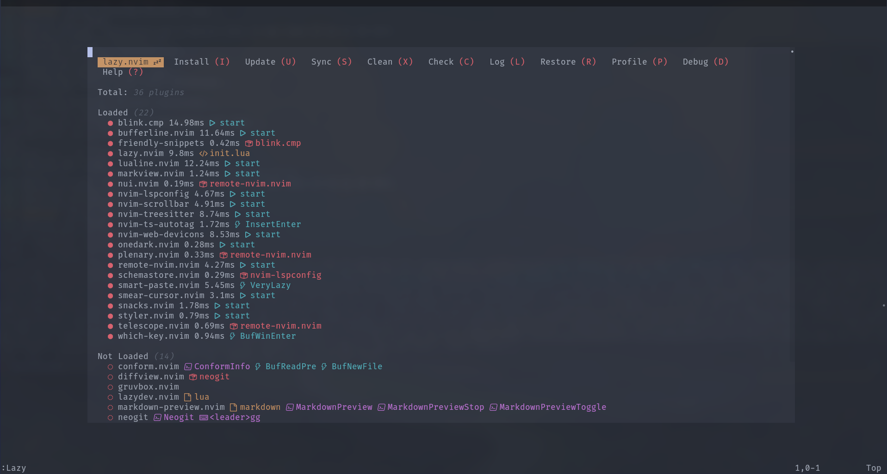

<div align="center">
  <br><br>
  <h1>Neovim</h1>
  <p><em>A full IDE, lazy-loaded to stay quick.</em></p>
  <a href="https://github.com/neovim/neovim"></a>
  <a href="https://github.com/neovim/neovim/stargazers"></a>
  
  
  <br><br>
  
</div>

> Built on **[Neovim](https://neovim.io)** — thanks to the Neovim contributors. ❤️

A full IDE on **Neovim 0.12**, managed by **[lazy.nvim](https://github.com/folke/lazy.nvim)** and built on modern-native foundations — the built-in LSP client (`vim.lsp.config`/`vim.lsp.enable`), Tree-sitter's `main` branch, and [blink.cmp](https://github.com/saghen/blink.cmp) completion. [snacks.nvim](https://github.com/folke/snacks.nvim) provides the picker, file explorer, notifier, terminal and dashboard in one place. Colorscheme is **onedark**; leader key is `m`.

Nothing here is a starter framework — it's a hand-rolled config, kept close to Neovim's native APIs so it stays maintainable without rebuilds.

## Gallery

<div align="center">
  <br>
  <sub><em>Editing with LSP annotations, Treesitter highlighting, and Trouble (symbols · diagnostics)</em></sub>
</div>

<div align="center">
  <br>
  <br>
  <sub><em>bufferline (buffer tabs) · lualine statusline</em></sub>
</div>

<div align="center">
  <br>
  <sub><em><code>:Lazy</code> — 36 plugins, most lazy-loaded (≈140 ms startup)</em></sub>
</div>

## Requirements

| Need | For |
|------|-----|
| **Neovim ≥ 0.11** (0.12 recommended) | native `vim.lsp.config`/`enable`, Tree-sitter `main` |
| **git**, a **C compiler**, **[tree-sitter CLI](https://github.com/tree-sitter/tree-sitter)** | plugin install + compiling Tree-sitter parsers (`pacman -S tree-sitter-cli`) |
| A **Nerd Font** (FiraCode Nerd Font here) | icons in the UI, statusline, picker |
| **ripgrep** + **fd** | the snacks picker (files / live grep) |
| **LSP servers** on `PATH` (no mason) | `lua_ls`, `pyrefly`, `bashls`, `clangd`, `ts_ls`, `html`, `graphql`, `sqls`, `dockerls`, `vimls`, `jsonls` |
| **Formatters / linters** (optional) | `prettier`, `shfmt`, `markdownlint` wired now; `stylua`/`isort`/`black`/`gofumpt`/`shellcheck`/`eslint`/`flake8` activate when installed |

## Structure

```
init.lua            → require("init")
lsp/                native 0.11+ per-server configs: lsp/<server>.lua returns a
                    table Neovim auto-merges over nvim-lspconfig's default.
                    Only servers that need overrides have a file here.
lua/
  init.lua          load order: plugins → general → settings → mappings → config → autocommands
  plugins.lua       lazy.nvim plugin specs
  general.lua       vim options
  settings.lua      globals + colorscheme
  mappings.lua      keybindings (leader = m)
  config.lua        one vim.lsp.enable({...}) list (+ jsonls deferred to first json file)
  autocommands.lua  autocmds (F9 file-runners, cursor restore, …)
  plugins/          plugin configs (lualine, bufferline, conform, lint, …)
  colors/           local palette used by the devicons overrides
```

Plugin catalogue: [plugins.md](plugins.md).

## Key subsystems

- **LSP** — native client, no framework wrapper. Overrides live in top-level `lsp/<server>.lua` (Neovim 0.11+ auto-discovery); servers are turned on with one `vim.lsp.enable({...})` and must be on `PATH`. `jsonls` is enabled lazily on the first json file (with [schemastore](https://github.com/b0o/schemastore.nvim) schemas) to keep startup fast.
- **Completion** — [blink.cmp](https://github.com/saghen/blink.cmp) (lsp / path / snippets / buffer) + [friendly-snippets](https://github.com/rafamadriz/friendly-snippets).
- **Formatting** — [conform.nvim](https://github.com/stevearc/conform.nvim), manual via `m lf` (LSP fallback). Wired for `shfmt` (`-i 4`), `prettier`, and `stylua`/`isort`/`black`/`gofumpt` once installed.
- **Linting** — [nvim-lint](https://github.com/mfussenegger/nvim-lint) on read/write/insert-leave. `markdownlint` active; others activate when installed.
- **Treesitter** — [nvim-treesitter](https://github.com/nvim-treesitter/nvim-treesitter) **`main` branch**: parsers compile via the `tree-sitter` CLI; highlighting starts per-filetype. Run `:TSUpdate` after install.

## 🔌 Plugins

The full set, grouped by job, lives in **[plugins.md](plugins.md)** — snacks.nvim for the UI hub (picker / explorer / notifier / terminal / dashboard), blink.cmp for completion, conform + nvim-lint for formatting/linting, nvim-treesitter (`main`), neogit/diffview for Git, trouble for diagnostics, and the usual UI/theme/markdown supporting cast.

## Notable keybindings

Leader = `m`. The `m l…` family is LSP, `m f…` is the snacks picker, `m x…` is Trouble.

| Key | Action |
|-----|--------|
| `m ld` / `m lD` | go to definition / declaration |
| `m li` / `m ly` | implementation / type definition |
| `m la` / `m le` | code action / rename |
| `m lf` | format (conform, LSP fallback) |
| `m ll` / `m ln` / `m lp` | diagnostics float / next / prev |
| `Ctrl-s` | find files (picker) |
| `m fg` / `m fb` / `m fl` | grep / buffers / recent |
| `m fh` / `m fm` / `m fr` | help / marks / registers |
| `m xx` / `m xr` | diagnostics / LSP references (Trouble) |
| `F9` | run current file (python / c / cpp / node / bash / ts) |
| `Alt-d` | toggle terminal (snacks) |
