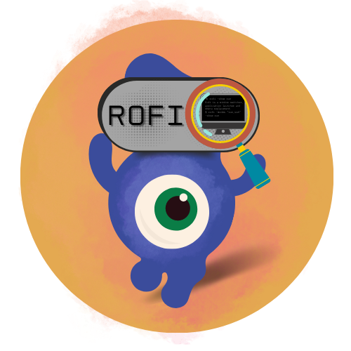

    
  <h1>Rofi</h1>
  
<em>Launcher, window switcher, and power menu for the rice.</em>

  
  
  

<!-- Screenshot slot: add assets/rofi-shot.png, then uncomment → 

 -->

> Built on **[Rofi](https://davatorium.github.io/rofi/)** by Dave Davenport. ❤️

The application launcher and dmenu stand-in for this BSPWM/X11 setup — it also handles the power menu and feeds a handful of smaller dmenu-style tools. [`config.rasi`](config.rasi) points the default theme at the **ribbon** launcher (`@theme "launchers/ribbon/ribbon_left.rasi"`); the stock ribbon colorscheme is a bit flat on its own, so the launcher scripts paint over it on every run.

The main pieces are a drun launcher in the ribbon theme and a separate power menu covering shutdown, reboot, lock, suspend, and logout — each with its own layouts. Beyond those, `launchers/` carries extra dmenu menus (web search, snippets, KeePassXC, bookmarks, manga, `locate`, and friends), with panel applets living under `applets/` and `bin/`.
